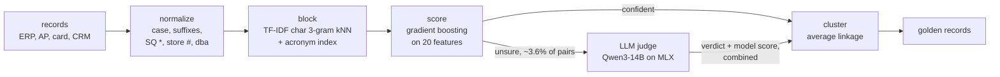
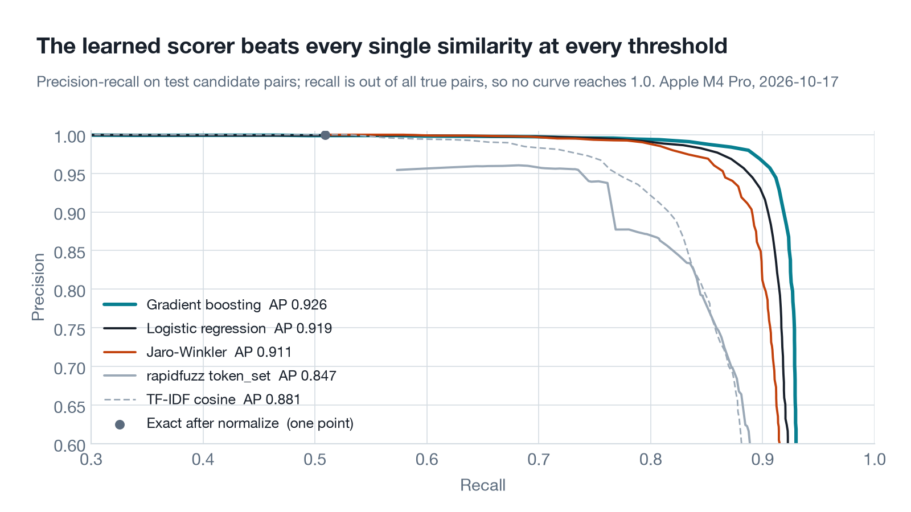
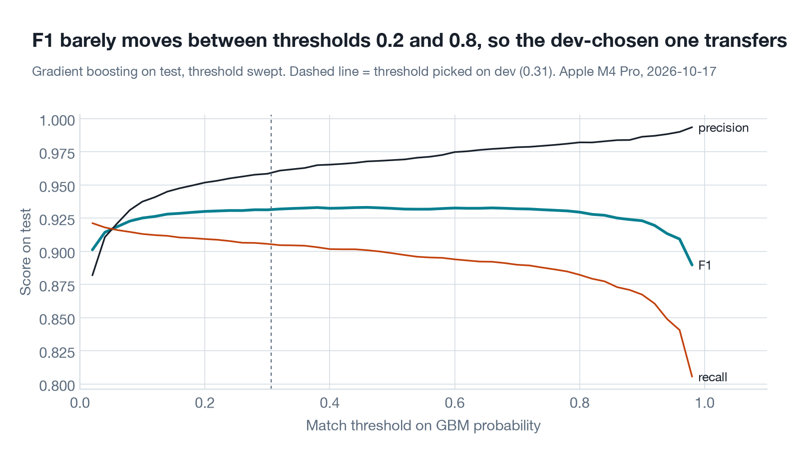

# vendormatch

Finds the records in your ERP, AP, card-feed and procurement exports that are the same company. Runs on a laptop with no API keys, and every stage is measured on a benchmark built from 5,465 real SEC companies.


## Results

Test split: 4,543 records of 1,500 real companies, 7,112 true duplicate pairs among 10.3 million possible pairs. Every threshold and the model were fit on a separate dev split of 2,000 other companies. Measured 2026-10-17 on an Apple M4 Pro (48 GB). Raw numbers are in [`results/`](results).

| Method | Precision | Recall | F1 | Pairs sent to the LLM |
|---|---|---|---|---|
| Exact match after normalizing | 1.000 | 0.509 | 0.675 | 0 |
| rapidfuzz `token_set_ratio` | 0.938 | 0.761 | 0.840 | 0 |
| Jaro-Winkler (best single similarity) | 0.953 | 0.864 | 0.906 | 0 |
| Gradient boosting on 20 features | 0.959 | 0.906 | 0.932 | 0 |
| Model + Qwen3-14B combined on the uncertain 3.6% (shipped) | 0.974 | 0.902 | 0.936 | 1,142 |
| Qwen3-14B overruling the model on the same 3.6% | 0.966 | 0.910 | 0.937 | 1,142 |
| Qwen3-14B on every candidate pair (estimated from a sample) | 0.801 | 0.847 | 0.823 | 32,089 |

The shipped cascade sends 3.6% of candidate pairs to a local Qwen3-14B and cuts false matches by 37% (275 to 173) for 28 more missed pairs out of 7,112. Sending it more pairs makes things worse, not better (chart above). Recall counts every true pair, including the 6.8% that blocking never proposes, so no method here can pass 0.932 recall.

- **Blocking** keeps 93.2% of true pairs while scoring 0.31% of all pairs (32,089 of 10.3 million).
- **Clusters**: average linkage over the shipped cascade's scores gives cluster-level pairwise F1 0.941 and B-cubed F1 0.963, and 85.7% of test companies come out as exactly their own records.
- **Speed without the LLM**: 50,000 records go from raw names to clusters in 31 s (1,596 records/s). The LLM adds 0.63 s per uncertain pair (1.33 s if it also writes a reason), about 12 minutes for the 1,142 band pairs in the test split.

## How it works



1. **Normalize.** Casefold, drop punctuation and legal forms (Inc, Corp., L.L.C., Ltd), map spellings to one token (International and Intl both become `intl`), and peel off what card feeds and AP systems wrap around a name: processor tags (`SQ *`, `TST*`, `PAYPAL *`), store numbers, reference codes, `Attn:` lines, SEC's `/DE/` tags. A `dba` or `fka` turns one record into two names. A suffix cut off by the 22-character card limit (`INCOR`) or one typo away (`Corl`) is dropped too.
2. **Block.** Comparing every record with every other is n²/2 pairs. Each name becomes a TF-IDF vector of character 3-grams and keeps its 10 nearest neighbours by cosine. A second index pairs short names with the multi-word names whose initials spell them (IBM next to International Business Machines), which character n-grams can't see.
3. **Score.** Each candidate pair gets 20 cheap features: rapidfuzz ratios, Jaro-Winkler, TF-IDF cosine, IDF-weighted token overlap, the rarest word only one side has, prefix (truncation) and acronym checks, number mismatches (Fund II vs Fund III), and address agreement. Gradient-boosted trees trained on dev turn them into a match probability.
4. **Judge.** Pairs within 20:1 odds of the model's threshold go to a local LLM, Qwen3-14B (4-bit, MLX). The prompt ends with `{"match":`, so the next token is the decision, and the probabilities of ` true` and ` false` at that position are its score. A short reason can be decoded after it. The system prompt's KV cache is reused across pairs, so each pair costs about 76 prompt tokens. Thinking mode is off. The verdict does not simply overrule the model: a three-parameter logistic regression fit on dev combines it with the model's score into the final probability.
5. **Cluster.** Average-linkage clustering on the sparse score graph: two clusters merge only if the average score over all their record pairs clears 0.5, with unscored pairs counted as 0. Each cluster's display name comes from the vendor master when there is one.

## Quickstart

```bash
git clone https://github.com/Amadeus415/vendormatch && cd vendormatch
uv sync                                                   # add --extra llm on Apple Silicon
uv run vendormatch dedupe data/test.csv --out clusters.csv
uv run vendormatch dedupe data/test.csv --out clusters.csv --llm   # fetches Qwen3-14B-4bit (8 GB) once
```

Input is any CSV with a `name` column (or `--name-col vendor_name`). `street`, `city`, `state`, `zip` and `source` (`erp`, `ap`, `card`, `crm`) are used when present. The output is the same rows plus `cluster_id`, `cluster_size` and `golden_name`.

From Python:

```python
from vendormatch import dedupe

records = [
    {"name": "Blue Bottle Coffee, Inc.", "city": "Oakland", "state": "CA", "source": "erp"},
    {"name": "SQ *BLUE BOTTLE COF", "city": "OAKLAND", "state": "CA", "source": "card"},
    {"name": "Delta Air Lines, Inc.", "city": "Atlanta", "state": "GA"},
    {"name": "Delta Apparel, Inc.", "city": "Duluth", "state": "GA"},
]
result = dedupe(records)   # dedupe(records, llm=LLMJudge()) adds the judge (from vendormatch.llm)
result.clusters            # array([0, 0, 1, 2])
result.golden              # {0: 'Blue Bottle Coffee, Inc.', 1: 'Delta Air Lines, Inc.', 2: 'Delta Apparel, Inc.'}
```

## The benchmark

There is no public dataset of messy vendor masters (nobody publishes their AP data), so I built one. The company names, addresses, former names and aliases are real. The mess is synthetic, applied by [`bench/generate.py`](bench/generate.py) with a fixed seed (20261017), and the ground truth is known because every record is generated from one company.

**Names.** Every company with a ticker in SEC EDGAR: `company_tickers.json`, then one `submissions` call per company for its registered name, business address and former names. Funds and trusts are dropped, which leaves 5,465 operating companies; 43% of them have a former name retired since 2005. Wikidata, joined on the SEC CIK, adds the names people actually use (`IBM`, `BMS`, `Dolby Labs`). I keep an alias only if it shares a word with the legal name or is its acronym and no other company uses it, which leaves aliases for 12% of companies. The extracted subset is in [`data/raw/`](data/raw).

**Mess.** Each company gets 1 to 8 records (22% get one, which is the realistic case), each from one of four systems with its own fields and its own failure modes:

| System | Fields | What goes wrong |
|---|---|---|
| ERP vendor master | name, street, city, state, zip | suffix swapped or dropped (`Inc` / `Incorporated` / `, Inc.` / `Corp`), casing, punctuation, abbreviations (`Intl`, `Mfg`, `Finl`), the odd typo, street abbreviations |
| AP invoices | payee name, remit-to address | more typos, `Attn: Accounts Receivable`, `DBA <alias>`, a former name (AP lags renames), names cut at 24-32 characters, a PO-box lockbox in another city |
| Corporate card feed | descriptor, city, state | uppercase, cut to 22 characters, a `SQ *` / `TST* ` / `PAYPAL *` prefix or a store number, the city of the charge rather than the company |
| Procurement / CRM | name, city, state | the common name or a Wikidata alias, an acronym only when it is also the company's ticker (IBM, AMD), sometimes a former name |

Every corruption is logged in the record's `noise` column, so errors can be broken down by cause. The generator knows 47 abbreviations; the normalizer resolves 27 of them, so it does not get credit for having the answer key. The card-processor list is shared, because that list is public knowledge.

**Hard negatives are real, not planted.** SEC already has `First Bancorp` in Puerto Rico and `First Bancorp` in North Carolina, `Eagle Bancorp` and `Eagle Bancorp Montana`, `Lennar` and `LENSAR`, `Tetra Tech` and `Tetra Technologies`. Different CIK means different legal entity, which is what a vendor master means by a different vendor. The test candidates include 2,034 pairs of different companies whose normalized names have a token-set similarity of 0.8 or more.

**Splits.** Companies, not records, are split: 2,000 for dev, 1,500 for test. The 50k scaling set uses every company outside dev. Thresholds, the model, the LLM band and the prompt were all chosen on dev.

## Results in detail

### Blocking keeps 93% of true pairs and drops 99.7% of comparisons


Character 3-gram neighbours beat "share a rare word" blocking at every budget, because a typo or a truncated word breaks token equality but only a few 3-grams. Going from k=10 to k=50 buys 0.8 points of recall for 5x the pairs. Of the 481 true pairs blocking misses, 364 involve a former name (`JDS Uniphase` and `Viavi`): no string method can see those, at any k.

### A small learned model beats every hand-tuned similarity




Jaro-Winkler is the strongest single similarity here (it rewards shared prefixes, which is what truncation leaves behind). `token_set_ratio`, the usual first reach in rapidfuzz, is the worst of the fuzzy scores on precision: it ignores extra words, so `Eagle Bancorp` fully "contains" `Eagle Bancorp Montana`. On the 2,034 confusable pairs of different companies, it false-matches 17.6%, Jaro-Winkler 10.4%, the gradient-boosted model 8.3%.



F1 moves less than 0.004 between thresholds 0.2 and 0.8 on test, so the threshold picked on dev (0.31) costs 0.002 against the best threshold in hindsight.

### Where recall is lost


Typos, truncation, store numbers and processor prefixes are mostly solved. Former names and aliases are not: most of them never get past blocking (the grey bar), so no scorer, LLM included, ever sees them.

### The LLM judge: useful on a small slice, harmful beyond it

The band is every pair whose model score is within 20:1 odds of the threshold: 1,142 test pairs, 3.6% of candidates, 378 of them true matches. Inside it the model is right 74% of the time. On the test band, Qwen3-14B alone does better than the model; on the dev band it does worse. Combining the two (below) beats both on dev, and is what ships:

| Uncertain band | Pairs | Accuracy | Precision | Recall | F1 |
|---|---|---|---|---|---|
| dev, model alone (out-of-fold) | 1,652 | 0.786 | 0.666 | 0.745 | 0.703 |
| dev, Qwen3-14B alone | 1,652 | 0.725 | 0.566 | 0.818 | 0.669 |
| dev, model + Qwen3-14B combined (5-fold CV) | 1,652 | 0.807 | 0.734 | 0.677 | 0.704 |
| test, model alone | 1,142 | 0.738 | 0.586 | 0.712 | 0.643 |
| test, Qwen3-14B alone | 1,142 | 0.810 | 0.680 | 0.804 | 0.737 |
| test, model + Qwen3-14B combined (shipped) | 1,142 | 0.803 | 0.733 | 0.638 | 0.682 |
| test, Qwen3-1.7B alone | 1,142 | 0.687 | 0.955 | 0.056 | 0.105 |
| test, Qwen3-0.6B alone | 1,142 | 0.331 | 0.331 | 1.000 | 0.497 |

The hero chart shows why "more LLM" is not the answer. Letting the LLM overrule the model on the most uncertain pairs first, F1 rises to 0.9386 at 2% of pairs, then falls: past about 7% the LLM is overruling decisions the model gets right, and on every pair it would score an estimated F1 of 0.823 (95% CI 0.75 to 0.89; the most uncertain 3,000 pairs were judged exhaustively, the other 29,089 through a random sample of 800). Over pairs the model is already sure about, even a small false-match rate adds up. The 2% peak was found on test, so I do not ship it; the band was fixed in advance.

What the LLM gets right that the model can't: renames and acronyms it knows (`PS` and Pershing Square), and differences the model's features miss (`HCM III Acquisition` vs `HCM IV`). What it gets wrong: it calls different companies with the same first word a match (`Invesco DB Energy Fund` and `Invesco DB Oil Fund`, `NRG Energy` and `Ring Energy` on dev), which is the opposite mistake from its first prompt.

**Combining instead of overruling.** The judge's own probability is almost always 0 or 1, so letting it overrule the model has two costs: it is wrong more often than that confidence says, and average linkage reads a 1.0 as strong evidence, so a single mistaken "match" pulls a record into the wrong cluster. I noticed the second one on test (raw overruling scored cluster F1 0.937 against 0.939 for the model alone, even though its pairs were better), then fixed it on dev only: a three-parameter logistic regression, `P(same) = sigmoid(b + w1 * z + w2 * said_match)` where `z` is the model's log-odds distance from its threshold, fit on the 1,652 dev band pairs ([`bench/calibrate.py`](bench/calibrate.py)). On dev it beats both inputs end to end (pair F1 0.931 against 0.930 for the model alone and 0.925 for the LLM overruling it; cluster pairwise F1 0.938 against 0.936 and 0.920. Small margins, but in the right direction on both). On test it gives the shipped numbers in the table at the top: 102 fewer false matches than the model alone (173 against 275, precision 0.959 to 0.974) for 28 more missed pairs, cluster pairwise F1 0.939 to 0.941, and a false-match rate on confusable different-company pairs of 5.9% against 8.3%. On test, raw overruling would have had a slightly higher pair F1 (0.937 against 0.936) with 55 more false matches and worse clusters; I'd still pick the combination, since it was chosen without looking at test and errs toward precision, which is what you want before merging vendor records.


The small models are not judges at all here, with the same prompt: Qwen3-0.6B says match to almost everything and Qwen3-1.7B says no match to 94% of real matches. Only the 14B beats the model it backs up, at about 11 times the per-pair cost of the 1.7B (0.63 s against 0.055 s). The 4B and 8B were not tested; the download link on this machine was too slow.

**Prompt.** The first prompt (v1) described the systems and warned about look-alike names. On 300 dev band pairs it reached F1 0.710 with recall 0.650: it read a remit-to PO box in another city, or a misspelling, as proof of a different company. v2 lists which differences are noise in finance exports and which are not, and reached F1 0.769 with recall 0.819 on the same pairs, against 0.687 for the model's out-of-fold scores. On the full dev band, v2 turned out to over-correct (the false matches above). Both prompts are in [`llm.py`](src/vendormatch/llm.py). For the record: I first started the v1 run on test, saw it reject obvious matches in the first 100 pairs, stopped it, threw those results away, and moved all prompt work to dev.

**Thinking.** With thinking on and a 256-token budget, on 100 random band pairs: accuracy 0.89 against 0.85 without thinking on the same pairs (F1 0.831 against 0.795), at 12.1 s per pair instead of 0.63, about 19 times the cost. The model used nearly the whole budget every time (253 tokens on average) and was cut off and made to answer. A 4-pair difference on 100 pairs is a small sample, so I read this as "probably helps, far too slow for this job" rather than a measured gain.

**Speed.** The decision is one token after a ~76-token prompt (the system prompt's KV cache is reused across pairs): 0.63 s per pair on the M4 Pro, 1.6 pairs/s. Writing a 12-token reason takes it to 1.33 s.

### Clustering: average linkage beats union-find


Union-find merges two clusters on any single match edge, so one false match glues two companies together and chains pull in records that look nothing alike. Average linkage needs most of the pairs between two clusters to agree. With the same scores it lifts cluster-level pairwise F1 from 0.761 to 0.857 for `token_set_ratio` and from 0.902 to 0.939 for the gradient-boosted model. B-cubed F1 for the model is 0.962, and 85.0% of test companies come out as exactly their own records, nothing missing and nothing extra; with the shipped cascade's scores that is 0.963 and 85.7%. The raw-overruling row shows the calibration problem described above: better pairs, slightly worse clusters.

### Scaling


Feature extraction, scoring and clustering grow linearly. Blocking grows faster (it compares each record against all others in sparse blocks) and is most of the runtime at 50k records. Pair F1 slides from 0.922 at 1k records to 0.883 at 50k: the 50k set gives each company about 15 records so that 50k records exist at all, and k=10 neighbours cannot reach all 105 pairs inside a 15-record cluster. Clustering recovers most of them (cluster pairwise F1 0.920 at 50k). These timings are the median of three runs on a machine other jobs were also using, so treat them as rough.

### What each method gets wrong

Real test pairs, from a fixed-seed random sample of each kind of error (the full lists are in [`results/cascade.json`](results/cascade.json) under `examples`). JW is the Jaro-Winkler similarity, GBM the model's match probability.

| Pair | Truth | What happened |
|---|---|---|
| `LENSAR INC` (Orlando) / `SQ *LENNAR` (Greenwich) | different | JW 0.92 says match; the model (0.05) weighs the rare word that differs |
| `CNR` (PA) / `Core Natural Resources ATTN AR DEPT` (Canonsburg, PA) | same | JW 0.61 misses it; the acronym feature gets the model to 0.93 |
| `Eagle Bancorp Inc` (Bethesda) / `Eagle Bancorp Montana, Inc.` (Helena) | different | the model is confident (0.97), so the LLM never sees it. The most common confident error: a real company whose name contains another's |
| `IN *CAPITAL SENIOR LIV` / `Sonida Senior Living Inc`, both Dallas | same | a rename (Capital Senior Living became Sonida); the model says 0.005 |
| `SQ *PNC FINANCIAL SERV` (Austin) / `Pnc Corp` (Pittsburgh) | same | model 0.07; LLM: "Same company with different name format and city." |
| `HCM III ACQUISITION Corp.` / `HCM IV ACQU STORE 5510` | different | model 0.42; LLM: "Different numbers (III vs IV) indicate distinct entities." |
| `PS` / `PERSHING SQUARE INCORPOFRATED` | same | model 0.03; LLM: "PS is likely an abbreviation of Pershing Square, matching the name and location." |
| `Senti Biosciences Holdings, Inc.` / `SP * YETI HOLDINGS INC` | different | model 0.15 was right; LLM: "Same company with different name format and location." |
| `Shoe Station Group` / `SQ *SHOE CARNIVAL`, both Fort Mill | same | model 0.79 was right; the rename is newer than the LLM, which says no |
| `EAGLE BANCORP MONTANA, INC.` / `Eagle Bancorp Inc` | different | both wrong; LLM: "Same company with name variation and different addresses." |

## What I learned

- **Blocking sets the ceiling, and it is not where I expected.** I assumed typos and truncation would be the hard part of candidate generation. They are not: character 3-grams handle them. Three quarters of the true pairs blocking loses involve a former name, which shares no characters with the current one. The LLM knows that JDS Uniphase became Viavi, but it never gets asked. The next thing to build is a blocker that asks the LLM, once per record, for the other names a company has gone by.
- **The LLM's priors were wrong for AP data until I said so.** The first prompt treated a different address or a misspelling as proof of different companies, which is right for most text and wrong for a remit-to lockbox or a card charge city. Saying so in the prompt raised the judge's recall on 300 dev band pairs from 0.65 to 0.82. Then it over-corrected: on the full dev band, v2 calls different companies that share a first word the same company. Prompts for this job need both kinds of counterexample, and a dev set big enough to show the second one.
- **`token_set_ratio` is a trap for vendor names.** It is the most common first choice, and it is the one that most often merges a company with a bigger company that shares its name.
- **Union-find is not a clustering method, it is a bug amplifier.** Every false-match edge becomes a merged cluster. Average linkage costs a few lines more.
- **My first out-of-fold scores leaked.** Splitting dev folds by pair put records of the same company on both sides of a fold, so the model looked more sure of itself on dev than it would be on new companies, and the dev band was easier than the test band. With folds split by company, the model's accuracy inside the band is 0.786 on dev and 0.738 on test.
- **A scaling benchmark finds bugs unit tests don't.** One feature recomputed `max()` over the whole IDF dictionary for every pair. Invisible at 4k records; at 50k, feature extraction took 77 s instead of 5 s (commit `248e908`).
- **More LLM is not better.** The judge helps on the 2 to 4% of pairs where the model is unsure and does damage everywhere else; on every pair it would score about 0.82 against 0.93 for the model alone. Treat it as a scalpel for the uncertain band, and measure where the band should end.
- **What didn't work:** batching several pairs into one forward pass. Prefill on the M4 Pro is compute-bound at these sizes, so 16 short prompts at once ran no faster than 16 in a row, and padding made it slightly slower. Small judges (0.6B, 1.7B) didn't work either: each collapsed to one answer for nearly every pair.

## Limitations

- The mess is synthetic. The generator encodes my idea of how ERP, AP and card systems corrupt names; real data will have failure modes I did not think of, and the corruption rates are guesses.
- Only public companies. A real vendor master is mostly small private vendors (the plumber, the caterer) with no SEC filing, no Wikidata entry and much less distinctive names.
- Ground truth is the legal entity (CIK). Subsidiaries and parents are different vendors here, which matches how AP treats them but not every use case.
- The LLM's gain is small (+0.005 pair F1, +0.003 cluster F1 on test) and depends on which pairs it sees: alone, it beat the model on the test band and lost to it on the dev band. The judge numbers come from one model, one prompt (revised once on dev), and greedy decisions. "LLM on every pair" is an estimate with a wide interval.
- Timings were taken on a machine shared with other jobs. The GPU runs held a lock so no other GPU job ran at the same time, but CPU timings (the scaling chart) are medians of three noisy runs.
- No standard entity-matching benchmark (Abt-Buy, Amazon-Google) yet. They are product matching, and the GPU budget went to the vendor benchmark.

## Reproduce

```bash
uv sync --extra llm
make data      # SEC + Wikidata download (~8k requests, rate-limited) and the splits; data/ is already committed
make bench     # blocking, scorers (retrains src/vendormatch/model.pkl), scaling
make llm       # every LLM run, resumable (about 90 minutes of GPU time on an M4 Pro)
make charts    # results/cascade.json and docs/*.png
make test
```

Every JSON in `results/` records the date, hardware, library versions and git commit it came from. LLM runs append to `results/llm/*.jsonl`, one line per judged pair, with the model's probability, tokens and seconds.

```
src/vendormatch/   normalize, blocking, features, scorer, llm, cluster, metrics, pipeline, cli
bench/             data download and generation, one script per benchmark stage, charts
data/              raw SEC/Wikidata extract, dev.csv, test.csv
results/           raw benchmark output (JSON, CSV, JSONL)
docs/              charts
```

## License

MIT. Company names and addresses come from SEC EDGAR (public domain) and Wikidata (CC0).
