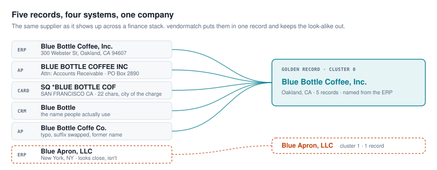
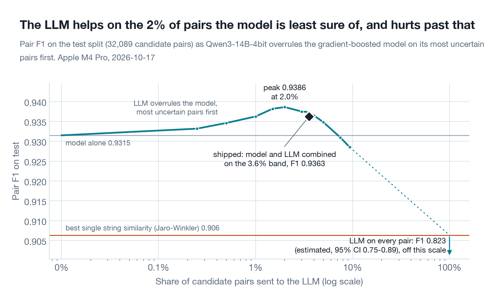
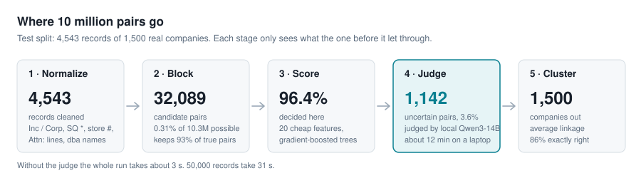
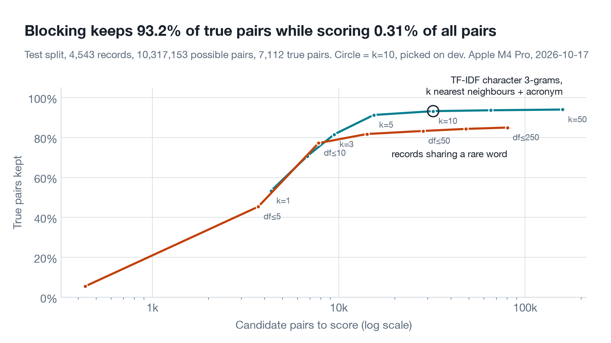
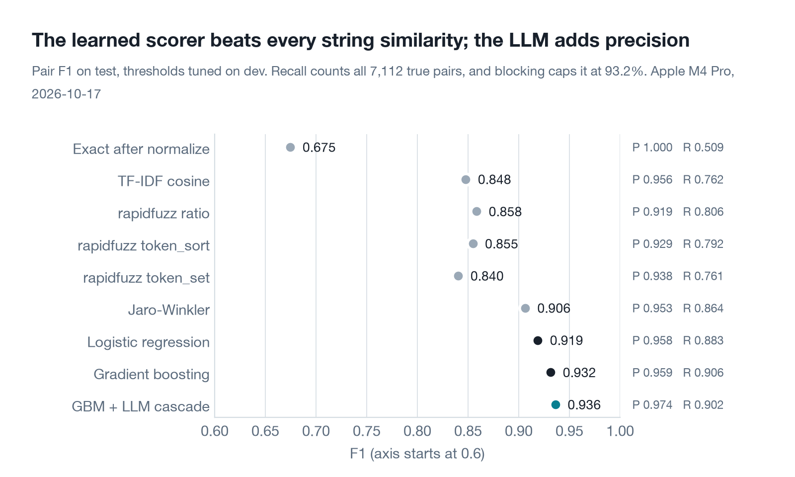
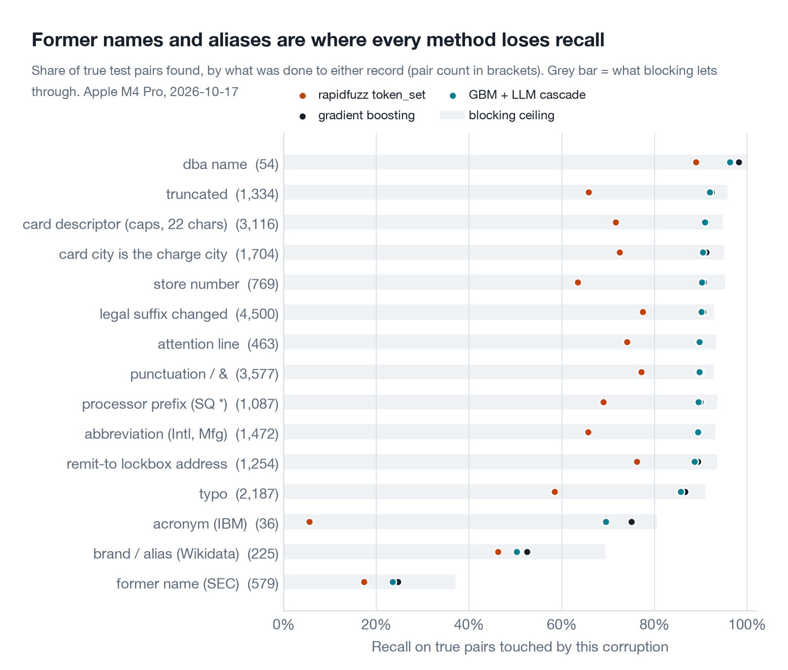
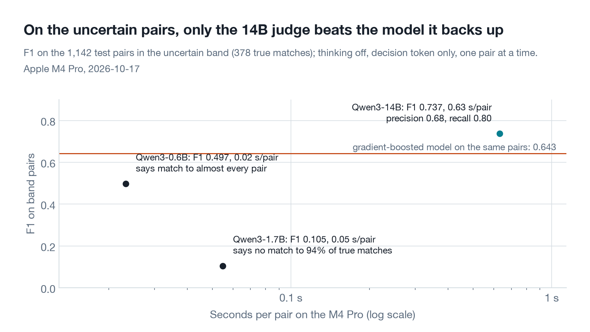
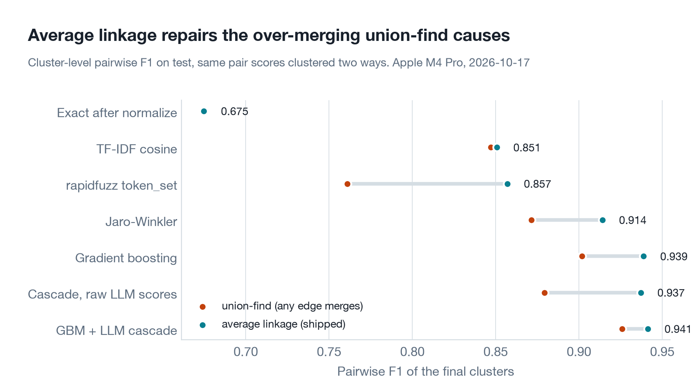
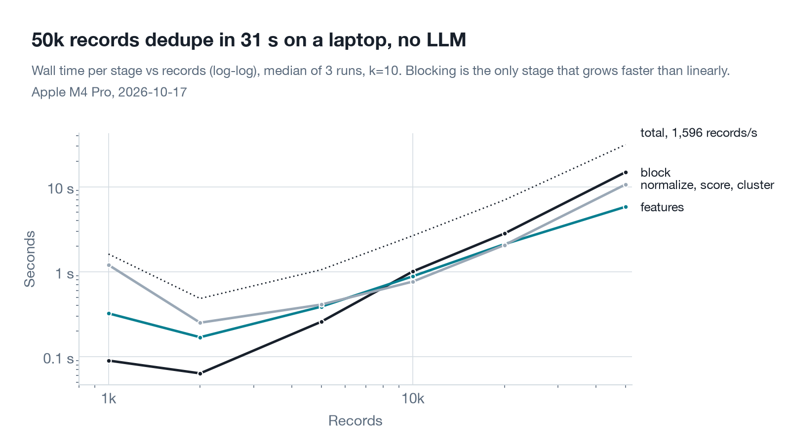

# vendormatch

**Finds the records in your ERP, AP, card-feed and CRM exports that are the same company.** Runs on a laptop, needs no API key, and every stage is measured on a benchmark built from 5,465 real companies.

[](https://github.com/Amadeus415/vendormatch/actions/workflows/ci.yml)


[](LICENSE)

<p align="center">
  
</p>

Every finance team has this problem. The same supplier is entered once in the ERP, again by AP with an `Attn:` line, again by the card processor cut to 22 characters, and again in the CRM under the name people actually use. Spend reports, contract checks and supplier counts are all wrong until those rows are one record.

## Try it

```bash
git clone https://github.com/Amadeus415/vendormatch && cd vendormatch
uv sync                                                            # add --extra llm on Apple Silicon
uv run vendormatch dedupe data/test.csv --out clusters.csv
uv run vendormatch dedupe data/test.csv --out clusters.csv --llm   # fetches Qwen3-14B-4bit (8 GB) once
```

Input is any CSV with a `name` column (or `--name-col vendor_name`). `street`, `city`, `state`, `zip` and `source` (`erp`, `ap`, `card`, `crm`) help when present. Output is the same rows plus `cluster_id`, `cluster_size` and `golden_name`.

```python
from vendormatch import dedupe

result = dedupe([
    {"name": "Blue Bottle Coffee, Inc.", "city": "Oakland", "state": "CA", "source": "erp"},
    {"name": "SQ *BLUE BOTTLE COF", "city": "OAKLAND", "state": "CA", "source": "card"},
    {"name": "Delta Air Lines, Inc.", "city": "Atlanta", "state": "GA"},
    {"name": "Delta Apparel, Inc.", "city": "Duluth", "state": "GA"},
])
result.clusters   # array([0, 0, 1, 2])
result.golden     # {0: 'Blue Bottle Coffee, Inc.', 1: 'Delta Air Lines, Inc.', 2: 'Delta Apparel, Inc.'}
```

## Results

Test split: 4,543 records of 1,500 real companies, 7,112 true duplicate pairs hiding among 10.3 million possible pairs. Nothing here was tuned on test. Measured 2026-10-17 on an Apple M4 Pro; raw numbers are in [`results/`](results).

| Method | Precision | Recall | F1 |
|---|---|---|---|
| Exact match after normalizing | 1.000 | 0.509 | 0.675 |
| rapidfuzz `token_set_ratio` (the usual first reach) | 0.938 | 0.761 | 0.840 |
| Jaro-Winkler (best single similarity) | 0.953 | 0.864 | 0.906 |
| Gradient boosting on 20 features | 0.959 | 0.906 | 0.932 |
| **Model + local LLM on the uncertain 3.6% (shipped)** | **0.974** | 0.902 | **0.936** |
| LLM on every pair (estimated from a sample) | 0.801 | 0.847 | 0.823 |

- **The LLM is a scalpel.** On the 3.6% of pairs the model is unsure of, it cuts false matches by 37% (275 to 173) for 28 more missed pairs. Give it more pairs and results get worse, not better.
- **Clusters come out clean.** 85.7% of test companies end up as exactly their own records, nothing missing and nothing extra. Cluster-level F1 0.941.
- **It's fast.** 50,000 records go from raw names to clusters in 31 s without the LLM. The LLM adds 0.63 s per uncertain pair, about 12 minutes for the whole test split.



## How it works

<p align="center">
  
</p>

1. **Normalize.** Lowercase, drop punctuation and legal forms (Inc, Corp., L.L.C.), map spellings to one token (`International` and `Intl` both become `intl`), and peel off what finance systems wrap around a name: `SQ *` and `PAYPAL *` prefixes, store numbers, `Attn:` lines, SEC's `/DE/` tags. A `dba` or `fka` turns one record into two names.
2. **Block.** Comparing every record with every other is n²/2 pairs. Instead, each name becomes a vector of character 3-grams and keeps its 10 nearest neighbours. A second index pairs short names with the multi-word names whose initials spell them (IBM next to International Business Machines).
3. **Score.** Each candidate pair gets 20 cheap features (rapidfuzz ratios, Jaro-Winkler, rare-word overlap, truncation and acronym checks, number mismatches like Fund II vs Fund III, address agreement). Gradient-boosted trees trained on dev turn them into a match probability.
4. **Judge.** Pairs within 20:1 odds of the threshold go to Qwen3-14B running locally on MLX. The prompt ends with `{"match":`, so the next token is the decision and its probability is the score. The system prompt's KV cache is reused, so a pair costs about 76 tokens. The verdict doesn't overrule the model; a small logistic regression fit on dev combines the two.
5. **Cluster.** Average linkage over the score graph: two clusters merge only if the average score across all their pairs clears 0.5. Each cluster is named from the vendor master when there is one.

## The benchmark

Nobody publishes their AP data, so there is no public dataset of messy vendor masters. I built one. The company names, addresses, former names and aliases are real; the mess is synthetic, applied with a fixed seed, and the ground truth is known because every record comes from one company.

**Names** are every operating company with a ticker in SEC EDGAR: 5,465 of them, 43% with a former name retired since 2005. Wikidata adds the names people use (`IBM`, `Dolby Labs`) for 12% of them. **Hard negatives are real, not planted:** SEC already has `First Bancorp` in Puerto Rico and in North Carolina, `Lennar` and `LENSAR`, `Tetra Tech` and `Tetra Technologies`.

**Mess.** Each company gets 1 to 8 records (22% get just one), each from a system with its own habits:

| System | What goes wrong |
|---|---|
| ERP vendor master | suffix swapped or dropped (`Inc` / `Incorporated` / `Corp`), casing, abbreviations (`Intl`, `Mfg`), the odd typo |
| AP invoices | more typos, `Attn: Accounts Receivable`, `DBA <alias>`, a former name (AP lags renames), names cut at 24 to 32 characters, a PO-box lockbox in another city |
| Corporate card feed | uppercase, cut to 22 characters, a `SQ *` / `TST*` / `PAYPAL *` prefix or a store number, the city of the charge rather than the company |
| Procurement / CRM | the common name or a Wikidata alias, an acronym when it is also the ticker (IBM, AMD), sometimes a former name |

Every corruption is logged per record, so errors can be broken down by cause. **Splits** are by company, not record: 2,000 for dev, 1,500 for test. The model, thresholds, LLM band and prompt were all chosen on dev.

## What the charts say

### Blocking sets the ceiling



Character 3-grams beat "share a rare word" at every budget, because a typo breaks a word but only a few 3-grams. Of the 481 true pairs blocking misses, 364 involve a former name (`JDS Uniphase` and `Viavi`), which no string method can see.

### A small learned model beats every hand-tuned similarity



`token_set_ratio`, the usual first reach, is the worst of the fuzzy scores on precision: it ignores extra words, so `Eagle Bancorp` fully "contains" `Eagle Bancorp Montana`. On the 2,034 confusable pairs of different companies, it false-matches 17.6%, Jaro-Winkler 10.4%, the model 8.3%, the shipped cascade 5.9%.

### Where recall is lost



Typos, truncation, store numbers and card prefixes are solved. Former names and aliases are not. Most of them never get past blocking (the grey bar), so no scorer, LLM included, ever sees them.

### The LLM: useful on a small slice, harmful beyond it



On the uncertain band the model alone is right 74% of the time. Qwen3-14B does better on the test band and worse on the dev band; combining the two beats both, and that is what ships. The smaller Qwen3 models are not judges at all here: 0.6B says match to almost everything, 1.7B says no match to 94% of real matches.

| Test band, 1,142 pairs | Accuracy | Precision | Recall | F1 |
|---|---|---|---|---|
| model alone | 0.738 | 0.586 | 0.712 | 0.643 |
| Qwen3-14B alone | 0.810 | 0.680 | 0.804 | 0.737 |
| model + Qwen3-14B combined (shipped) | 0.803 | 0.733 | 0.638 | 0.682 |

Why combine instead of letting the LLM overrule? Its probability is almost always 0 or 1, and average linkage reads a 1.0 as strong evidence, so one mistaken "match" drags a record into the wrong cluster. The combination errs toward precision, which is what you want before merging vendor records.

Two things that didn't pay off: **thinking mode** (accuracy 0.89 vs 0.85 on 100 pairs, at 19 times the cost) and **batching** pairs into one forward pass (prefill is compute-bound on the M4 Pro, so 16 at once ran no faster than 16 in a row).

### Clustering: average linkage beats union-find



Union-find merges two clusters on any single edge, so one false match glues two companies together. Average linkage needs most of the pairs between two clusters to agree. Same scores, cluster F1 goes from 0.902 to 0.939 for the model.

### Scaling



Everything grows linearly except blocking, which is most of the runtime at 50k records. Pair F1 slides from 0.922 at 1k to 0.883 at 50k because the 50k set packs about 15 records per company and 10 neighbours can't reach all 105 pairs inside a cluster; clustering recovers most of them.

## What each method gets wrong

Real test pairs. JW is Jaro-Winkler, GBM the model's match probability.

| Pair | Truth | What happened |
|---|---|---|
| `LENSAR INC` (Orlando) / `SQ *LENNAR` (Greenwich) | different | JW 0.92 says match; the model (0.05) weighs the rare word that differs |
| `CNR` (PA) / `Core Natural Resources ATTN AR DEPT` (PA) | same | JW 0.61 misses it; the acronym feature gets the model to 0.93 |
| `Eagle Bancorp Inc` / `Eagle Bancorp Montana, Inc.` | different | the model is confident (0.97), so the LLM never sees it. The most common confident error |
| `IN *CAPITAL SENIOR LIV` / `Sonida Senior Living Inc` | same | a rename; the model says 0.005 and nothing downstream can fix it |
| `PS` / `PERSHING SQUARE INCORPOFRATED` | same | model 0.03; LLM: "PS is likely an abbreviation of Pershing Square" |
| `HCM III ACQUISITION Corp.` / `HCM IV ACQU STORE 5510` | different | model 0.42; LLM: "Different numbers (III vs IV) indicate distinct entities" |
| `Shoe Station Group` / `SQ *SHOE CARNIVAL` | same | model 0.79 was right; the rename is newer than the LLM, which says no |

## What I learned

- **Blocking is the ceiling, and not where I expected.** I assumed typos and truncation would be hard. They aren't. Three quarters of the pairs blocking loses involve a former name, which shares no characters with the current one. The LLM knows JDS Uniphase became Viavi, but it never gets asked. Next: a blocker that asks the LLM, once per record, what else a company has been called.
- **The LLM's priors were wrong for AP data until I said so.** The first prompt read a different address or a misspelling as proof of different companies. Right for most text, wrong for a remit-to lockbox. Saying so raised its recall on 300 dev pairs from 0.65 to 0.82. Then it over-corrected and started merging companies that share a first word. Prompts for this job need both kinds of counterexample.
- **`token_set_ratio` is a trap for vendor names.** It is the most common first choice and the one that most often merges a company with a bigger company that contains its name.
- **Union-find is a bug amplifier.** Every false-match edge becomes a merged cluster. Average linkage costs a few lines more.
- **My first cross-validation leaked.** Splitting folds by pair put records of the same company on both sides, so the model looked more confident on dev than it would be on new companies. Splitting by company fixed it.
- **A scaling benchmark finds bugs tests don't.** One feature recomputed `max()` over the whole IDF dictionary for every pair. Invisible at 4k records; at 50k, feature extraction took 77 s instead of 5 s.

## Limits

- The mess is synthetic. The generator encodes my idea of how ERP, AP and card systems mangle names; real data will have failure modes I didn't think of.
- Only public companies. A real vendor master is mostly small private vendors (the plumber, the caterer) with no SEC filing and much less distinctive names.
- Ground truth is the legal entity. Subsidiaries and parents count as different vendors, which is how AP treats them but not every use case.
- The LLM's gain is small (+0.005 pair F1 on test) and comes from one model, one prompt revised once on dev, and greedy decisions.

## Reproduce

```bash
uv sync --extra llm
make data      # SEC + Wikidata download (~8k rate-limited requests) and the splits; data/ is already committed
make bench     # blocking, scorers (retrains src/vendormatch/model.pkl), scaling
make llm       # every LLM run, resumable (about 90 minutes of GPU time on an M4 Pro)
make charts    # results/cascade.json and docs/*.png
make test
```

Every JSON in `results/` records the date, hardware, library versions and git commit it came from.

```
src/vendormatch/   normalize, blocking, features, scorer, llm, cluster, metrics, pipeline, cli
bench/             data download and generation, one script per benchmark stage, charts
data/              raw SEC/Wikidata extract, dev.csv, test.csv
results/           raw benchmark output (JSON, CSV, JSONL)
docs/              charts and diagrams
```

## License

MIT. Company names and addresses come from SEC EDGAR (public domain) and Wikidata (CC0).
